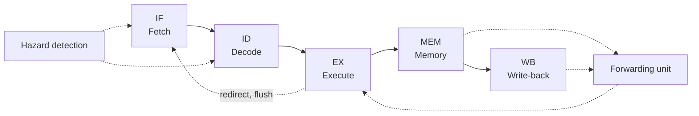

# riscv-vhdl


A **5-stage pipelined RISC-V (RV32I) CPU** in VHDL, built in phases and verified at three levels: self-checking unit testbenches, constrained-random programs compared with an independent Python reference model, and C programs compiled with the RISC-V GCC toolchain and checked against the host compiler. The single-cycle baseline, the 5-stage pipeline and the C-program flow are complete; synthesis and timing analysis are done: on an ECP5 FPGA the pipeline turns out slower than the single-cycle core (see [Synthesis results](#synthesis-results)).

The whole project runs in simulation: **no FPGA board required**.

## Status

| Phase | State |
|---|---|
| 1. Foundations | Done |
| 2. Single-cycle CPU | Done: verified against an independent reference model |
| 3. Pipelining | Done: forwarding, load-use stall and flush, verified against the reference model |
| 4. Program-level verification | Done: C programs compiled with GCC agree with the host compiler, the model and both cores |
| 5. Synthesis and analysis | Done: ECP5 synthesis, Fmax over 5 seeds, execution-time comparison |
| 6. Documentation | Planned |

## Why this project

- Practice real RTL design: synthesizable VHDL, pipelining, hazards and timing.
- Treat verification as a first-class part of the design, not an afterthought.
- Produce measurable results: maximum frequency, resource usage and CPI.

## The CPU today

Two cores share the same ports and the same memory wrapper. `cpu_sc` selects the core with the generic `PIPELINED` (default `false`).

### Modules

| Module | Role |
|---|---|
| `alu`, `alu_pkg` | Arithmetic, logic, shifts and comparisons |
| `regfile` | 32 x 32-bit register file, `x0` hardwired to zero, optional same-cycle write-to-read bypass (`BYPASS` generic, used by the pipeline) |
| `immgen` | Immediate generator for I, S, B, U and J formats |
| `control`, `ctrl_pkg` | Instruction decoder and control signals |
| `branch_unit` | Branch decision logic |
| `imem` | Instruction memory (hex file or test-bench load port) |
| `dmem` | Byte-addressable little-endian data memory (optional load port for initial data in test benches) |
| `cpu_core` | Single-cycle processor logic: the correctness baseline and the CPI reference |
| `cpu_pipe` | 5-stage pipelined processor logic (same ports as `cpu_core`) |
| `forward_unit` | EX-stage forwarding from EX/MEM and MEM/WB |
| `cpu_sc` | Selected core (`PIPELINED` generic) with instruction and data memories |

## Pipeline microarchitecture



| Feature | Design choice |
|---|---|
| ISA | RV32I base integer instruction set |
| Pipeline | Classic 5 stages: IF, ID, EX, MEM, WB |
| Data hazards | Forwarding from EX/MEM and MEM/WB, same-cycle register file bypass, one-cycle stall on load-use |
| Control hazards | Branches and jumps resolved in EX, predict-not-taken, flush on redirect (2-cycle penalty) |
| Memories | Separate instruction and data memories, outside the core |

## Verification strategy

1. **Unit tests:** self-checking VHDL testbenches for every block, using `assert` statements.
2. **Instruction-level tests:** constrained-random RV32I programs generated in Python, executed through cocotb and compared with an independent reference model. The pipeline is also checked against an exact cycle formula (instructions + load-use stalls + 2 per redirect + 1).
3. **Mutation checks:** intentional RTL bugs introduced using `scripts/mutate.sh` to verify that the regression detects errors. Bugs planted in the single-cycle core, forwarding, load-use stall, flush, register file bypass and the data-memory load path: 46 of 46 caught by at least one test target. The C programs alone catch 7 of the 8 flush and redirect bugs; the one they cannot see (a JALR target with bit 0 set) never occurs in compiled code, and the random programs catch it.
4. **Program-level tests:** C programs compiled with the RISC-V GCC toolchain. For each program, the result computed by the **host compiler**, the Python model, the single-cycle core and the pipelined core must agree, along with every store, all 32 registers and the data memory. The CRC-32 program is also checked against the published check value for `"123456789"` (`0xCBF43926`).
5. **Encoder cross-check:** `scripts/check_encoder.py` compares the Python instruction encoder with the GNU assembler on thousands of random instructions.
6. **Pipeline invariants:** `cpu_pipe.vhd` contains assertions checked on every cycle: a load-use stall and a redirect never coincide, x0 is never forwarded, a redirect flushes IF/ID and ID/EX, and a stall holds the PC and IF/ID and inserts a bubble. Every test that runs the pipeline enforces them, and five planted bugs each triggered the matching assertion.
7. **Continuous integration:** the full regression, including the C programs, runs on every push.

## Getting started

### Requirements

- [GHDL](https://github.com/ghdl/ghdl) with the LLVM backend (`ghdl-llvm`, VHDL-2008 support; required by cocotb)
- [cocotb](https://www.cocotb.org/) 2.x and Python 3 (installed from `requirements.txt`)
- RISC-V GCC (`riscv64-unknown-elf-gcc` with an `rv32i` multilib) and the host `gcc`, for `make c_regress`
- [GTKWave](https://gtkwave.sourceforge.net/) to inspect waveforms
- `make`

On Ubuntu or WSL:

```bash
sudo apt install -y ghdl-llvm gtkwave make python3-venv gcc gcc-riscv64-unknown-elf binutils-riscv64-unknown-elf
python3 -m venv .venv && source .venv/bin/activate
pip install -r requirements.txt
```

If `ghdl --version` does not mention the LLVM backend, remove the mcode package (`sudo apt remove ghdl-mcode`): cocotb needs VPI support, which mcode does not provide.

### Run the tests

```bash
make test        # run every VHDL testbench and every cocotb test
make c_regress   # build every C program and run it on both cores
make alu_tb      # run a single VHDL testbench
make cocotb      # run only cocotb tests
make clean       # remove generated files
```

New VHDL testbenches named `tb/<name>_tb.vhd` and Python tests named `tests/test_*.py` are discovered automatically. `scripts/ci_local.sh` runs the whole regression on a fresh clone of the committed state, which is exactly what CI sees.

### Random CPU regression

```bash
RV_PROGRAMS=500 python tests/test_cpu_random.py
RV_SEED0=1234 RV_PROGRAMS=1 python tests/test_cpu_random.py
```

The seed allows you to reproduce a failing random program.

The same generator, with a hazard-heavy mode, drives the pipelined core:

```bash
RV_PROGRAMS=500 python tests/test_cpu_pipe_random.py
RV_HAZARD=0.0 RV_PROGRAMS=200 python tests/test_cpu_pipe_random.py
```

### Mutation checks

```bash
scripts/mutate.sh rtl/cpu_core.vhd cpu_regress 's/<pattern>/<replacement>/'
scripts/mutate.sh rtl/forward_unit.vhd pipe_regress 's/<pattern>/<replacement>/'
scripts/mutate.sh rtl/dmem.vhd c_regress 's/<pattern>/<replacement>/'
```

### View waveforms

Each run writes a waveform file to `sim/`:

```bash
gtkwave sim/alu_tb.ghw
```

## C programs

Programs in `sw/programs/` are compiled for the bare CPU (`-march=rv32i -mabi=ilp32`, no operating system, no C library) and loaded into the simulated memories.

```bash
make c_regress                                  # all programs, both cores
python scripts/build_c.py sw/programs/sum.c     # one program: sim/c/sum.{elf,dis,hex,data.hex,json}
python scripts/c_coverage.py                    # static: which RV32I instructions appear in the binaries
python scripts/c_exec_coverage.py               # dynamic: which ones the model executes, and branch outcomes
python scripts/check_encoder.py 100 1           # Python encoder vs the GNU assembler
```

| Region | Addresses | Holds |
|---|---|---|
| Instruction memory | `0x0000` to `0x1FFF` (8 KiB) | `.text`, starting with `_start` at address 0 |
| Data memory | `0x2000` to `0x3FFF` (8 KiB) | `.rodata`, `.data`, `.bss`, and the stack growing down from `0x4000` |

How it works:

- `sw/crt0.S` sets the stack pointer, clears `.bss`, calls `main` and ends in the halt loop `jal x0, 0`. `sw/link.ld` places code and data in the two regions.
- Multiplication and division have no hardware support in RV32I: the compiler calls software routines from `libgcc`, which run on the CPU like any other code.
- `scripts/build_c.py` rejects any instruction outside the base ISA, then writes the instruction image and the initial data image (`.rodata`, `.data`) that the testbench loads through load ports.
- Each program also runs on the host with the host compiler. That result is the independent reference.
- All 37 RV32I instructions execute in the programs, and every branch type is seen both taken and not taken (`scripts/c_exec_coverage.py`). GCC did not emit `slti` for these programs, and `bge` was executed but never taken, so `cmpi.c` forces both with inline assembly; the host build uses plain C, so the host result stays the reference.

To add a program, put a `.c` file with `int main(void)` in `sw/programs/`; `make c_regress` picks it up. Keep inputs `volatile` (so the compiler cannot compute the answer at build time) and avoid undefined behaviour, because the host compiler must produce the same value.

### Measured CPI

Printed by `make c_regress` (cycles per instruction; the single-cycle core is 1 plus a fixed overhead of one cycle):

| Program | Instructions | Single-cycle CPI | Pipeline CPI |
|---|---|---|---|
| bits | 4588 | 1.000 | 1.317 |
| bytes | 1078 | 1.001 | 1.199 |
| cmp | 5608 | 1.000 | 1.106 |
| cmpi | 9477 | 1.000 | 1.094 |
| crc | 141 | 1.007 | 1.234 |
| gcd | 6426 | 1.000 | 1.471 |
| matmul | 3626 | 1.000 | 1.411 |
| rec | 32570 | 1.000 | 1.364 |
| sort | 1256 | 1.001 | 1.404 |
| sum | 420 | 1.002 | 1.729 |
| **All programs** | 65190 | 1.000 | 1.312 |

The last row weights each program by its instruction count, so it depends on the mix: `rec` is half of the instructions, and `cmp` and `cmpi` are coverage programs, not workloads. The per-program range (1.09 to 1.73) says more than the average.

CPI is not performance: execution time is cycles times clock period, so the pipeline only wins if its clock frequency beats the single-cycle clock by a factor larger than its CPI (1.09 to 1.73 here, depending on the program). That measurement is in [Synthesis results](#synthesis-results).

## Synthesis results

Both cores were synthesized for a **Lattice ECP5 LFE5U-85F (CABGA381)** with the open-source flow: `ghdl --synth --out=verilog` -> Yosys `synth_ecp5` -> nextpnr-ecp5 (GHDL 5.0.1, Yosys 0.52, nextpnr 0.9). No board is involved. The wrapper `synth/synth_top.vhd` instantiates `cpu_sc` with a 256-word instruction memory and a 1 KiB data memory, the same for both cores. The instruction memory holds `sim/c/sort.hex`, so run `make c_regress` once before synthesizing.

```bash
scripts/synth.sh false          # single-cycle (args: true|false [seed] [target MHz])
scripts/synth.sh true           # pipelined
scripts/synth_sweep.sh 100 5    # target 100 MHz, seeds 1 to 5, both cores
make c_regress > /tmp/cr.log 2>&1
python scripts/speedup.py /tmp/cr.log 44.17 47.58   # cycles / median Fmax
```

| | Single-cycle | Pipelined |
|---|---|---|
| Fmax, median of 5 seeds | 44.17 MHz | 47.58 MHz |
| Fmax, range | 43.90 to 45.23 MHz | 44.90 to 49.05 MHz |
| LUT/logic cells (TRELLIS_COMB) | 2518 | 3553 |
| Flip-flops (TRELLIS_FF) | 33 | 439 |
| Block RAM (DP16KD) | 0 | 1 |

Execution time is cycles divided by the median Fmax:

| Program | Single-cycle (us) | Pipelined (us) | Speedup of the pipeline |
|---|---|---|---|
| bits | 103.9 | 127.0 | 0.818 |
| bytes | 24.4 | 27.2 | 0.899 |
| cmp | 127.0 | 130.4 | 0.974 |
| cmpi | 214.6 | 217.9 | 0.985 |
| crc | 3.2 | 3.7 | 0.879 |
| gcd | 145.5 | 198.7 | 0.732 |
| matmul | 82.1 | 107.5 | 0.764 |
| rec | 737.4 | 933.4 | 0.790 |
| sort | 28.5 | 37.1 | 0.768 |
| sum | 9.5 | 15.3 | 0.625 |

**On this device and with these cores, the pipeline is slower on all ten programs.** Its median clock is only about 8% higher (the seed ranges overlap), which does not pay for a CPI of 1.09 to 1.73. The critical paths explain it: both cores have about 20 cells on the longest path, and 72 to 78% of the delay is routing (single-cycle: 4.97 ns logic, 17.81 ns routing; pipelined: 5.72 ns logic, 14.67 ns routing, seed 3). The single-cycle path runs from the PC through the register file and the data memory back to the register file. The pipelined path runs through the EX stage (forwarding, ALU, branch decision and the flush of a pipeline register), so the longest stage is not much shorter than the whole single-cycle path.

Limits of these numbers:

- One device, one tool flow, one ROM image (`sort.hex`), and only 5 placement seeds.
- The instruction ROM is folded into logic in the single-cycle build and mapped to a block RAM in the pipelined build, so the two builds are not mapped identically.
- The memories are asynchronous (distributed RAM). Synchronous memories would give different numbers.
- The synthesized netlist has not been simulated.
- Execution time is cycles divided by Fmax only: power and area are not part of the comparison.

Two RTL changes were made for synthesis, each followed by the full regression with identical cycle counts: `dmem` was split into four byte lanes so it maps to RAM, and the ALU now uses one adder/subtractor and one shared shifter.

## Repository structure

```text
rtl/       synthesizable VHDL (design under test)
tb/        self-checking VHDL testbenches
synth/     synthesis wrapper for the ECP5 flow
tb/data/   hex programs used by CPU tests
tests/     cocotb tests, RV32I encoder, reference model, random generator
sw/        C programs, startup code and linker script
scripts/   C build flow, mutation checks, encoder cross-check, clean-clone regression
sim/       generated waveforms and build files (git-ignored)
docs/      project proposal and synthesis results
.github/   CI workflow
```

## Coding conventions

- VHDL-2008, `ieee.numeric_std` only.
- Synthesizable code stays in `rtl/`; delays and `wait for` belong in `tb/`.
- Every module has a testbench before the next one is started.
- Testbenches are self-checking: a failing check must make `make test` fail.

## Roadmap

Development is organized in phases, tracked through commits and GitHub milestones:

1. **Foundations (done):** toolchain, basic blocks, FSMs, first testbenches.
2. **Single-cycle CPU (done):** ALU, register file, decoder, memories and datapath.
3. **Pipelining (done):** five stages, forwarding, hazard detection and branch handling.
4. **Program-level verification (done):** C programs, host-compiler and model comparison, initialized data, instruction coverage and CI.
5. **Synthesis and analysis (done):** timing and resource reports, CPI and performance comparison.
6. **Documentation (planned):** architecture diagrams and final report.

Stretch goals: instruction/data cache, UART peripheral, M extension, custom instruction.

## Tools

GHDL, GTKWave, cocotb, Yosys / nextpnr, RISC-V GCC, GitHub Actions

## Author

**Chadha Ben Said**, computer engineering student at ENSI.
GitHub: [@bensaid25](https://github.com/bensaid25)

## License

MIT
