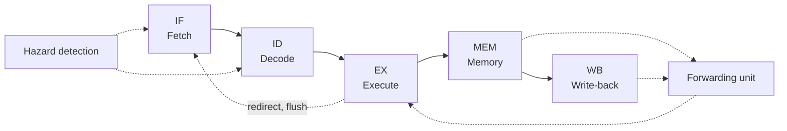

# riscv-vhdl


A **5-stage pipelined RISC-V (RV32I) CPU** in VHDL, built in phases: the single-cycle baseline and the 5-stage pipeline are complete and verified; program-level verification and synthesis come next. Verified with self-checking testbenches, Python (cocotb) tests and continuous integration.

The whole project runs in simulation: **no FPGA board required**.

## Status

| Phase | State |
|---|---|
| 1. Foundations | Done |
| 2. Single-cycle CPU | Done: verified against an independent reference model |
| 3. Pipelining | Done: forwarding, load-use stall and flush, verified against the reference model |
| 4. Program-level verification | Next |
| 5. Synthesis and analysis | Planned |
| 6. Documentation | Planned |

## Why this project

- Practice real RTL design: synthesizable VHDL, pipelining, hazards and timing.
- Treat verification as a first-class part of the design, not an afterthought.
- Produce measurable results: maximum frequency, resource usage and CPI.

## The CPU today

Two cores share the same ports and the same memory wrapper. `cpu_sc` selects the core with the generic `PIPELINED` (default `false`).

### Single-cycle baseline

The single-cycle RV32I CPU executes one instruction per clock cycle. It is the correctness baseline for the pipelined version and the reference for the CPI comparison.

| Module | Role |
|---|---|
| `alu`, `alu_pkg` | Arithmetic, logic, shifts and comparisons |
| `regfile` | 32 x 32-bit register file, `x0` hardwired to zero, optional same-cycle write-to-read bypass (`BYPASS` generic, used by the pipeline) |
| `immgen` | Immediate generator for I, S, B, U and J formats |
| `control`, `ctrl_pkg` | Instruction decoder and control signals |
| `branch_unit` | Branch decision logic |
| `imem` | Instruction memory |
| `dmem` | Byte-addressable little-endian data memory |
| `cpu_core` | Single-cycle processor logic |
| `cpu_pipe` | 5-stage pipelined processor logic (same ports as `cpu_core`) |
| `forward_unit` | EX-stage forwarding from EX/MEM and MEM/WB |
| `cpu_sc` | Selected core (`PIPELINED` generic) with instruction and data memories |

## Pipeline microarchitecture



| Feature | Design choice |
|---|---|
| ISA | RV32I base integer instruction set |
| Pipeline | Classic 5 stages: IF, ID, EX, MEM, WB |
| Data hazards | Forwarding from EX/MEM and MEM/WB, same-cycle register file bypass, one-cycle stall on load-use |
| Control hazards | Branches and jumps resolved in EX, predict-not-taken, flush on redirect (2-cycle penalty) |
| Memories | Separate instruction and data memories, outside the core |

## Verification strategy

1. **Unit tests:** self-checking VHDL testbenches for every block, using `assert` statements.
2. **Instruction-level tests:** constrained-random RV32I programs generated in Python, executed through cocotb and compared with an independent reference model. The pipeline is also checked against an exact cycle formula (instructions + load-use stalls + 2 per redirect + 1).
3. **Mutation checks:** intentional RTL bugs introduced using `scripts/mutate.sh` to verify that the regression detects errors. Bugs planted in the single-cycle core, forwarding, load-use stall, flush and register file bypass: 40 of 40 caught.
4. **Program-level tests (planned):** C programs compiled with the RISC-V GCC toolchain and compared against a reference model.
5. **Continuous integration:** automated regression on every push.

## Getting started

### Requirements

- [GHDL](https://github.com/ghdl/ghdl) with the LLVM backend (`ghdl-llvm`, VHDL-2008 support; required by cocotb)
- [cocotb](https://www.cocotb.org/) 2.x and Python 3 (installed from `requirements.txt`)
- [GTKWave](https://gtkwave.sourceforge.net/) to inspect waveforms
- `make`
- Optional: RISC-V GCC toolchain (for the C-program tests in later phases)

On Ubuntu or WSL:

```bash
sudo apt install -y ghdl-llvm gtkwave make python3-venv
python3 -m venv ~/.venvs/hdl && source ~/.venvs/hdl/bin/activate
pip install -r requirements.txt
```

### Run the tests

```bash
make test        # run every testbench
make alu_tb      # run a single VHDL testbench
make cocotb      # run only cocotb tests
make clean       # remove generated files
```

New VHDL testbenches named `tb/<name>_tb.vhd` and Python tests named `tests/test_*.py` are discovered automatically.

### Random CPU regression

```bash
RV_PROGRAMS=500 python tests/test_cpu_random.py
RV_SEED0=1234 RV_PROGRAMS=1 python tests/test_cpu_random.py
```

The seed allows you to reproduce a failing random program.

The same generator, with a hazard-heavy mode, drives the pipelined core:

```bash
RV_PROGRAMS=500 python tests/test_cpu_pipe_random.py
RV_HAZARD=0.0 RV_PROGRAMS=200 python tests/test_cpu_pipe_random.py
```

### Mutation checks

```bash
scripts/mutate.sh rtl/cpu_core.vhd cpu_regress 's/<pattern>/<replacement>/'
scripts/mutate.sh rtl/forward_unit.vhd pipe_regress 's/<pattern>/<replacement>/'
```

### View waveforms

Each run writes a waveform file to `sim/`:

```bash
gtkwave sim/alu_tb.ghw
```

## Repository structure

```text
rtl/       synthesizable VHDL (design under test)
tb/        self-checking VHDL testbenches
tb/data/   hex programs used by CPU tests
tests/     cocotb tests, RV32I encoder, reference model and random generator
scripts/   mutation-check helper
sim/       generated waveforms and build files (git-ignored)
docs/      project proposal and design notes
.github/   CI workflow
```

## Coding conventions

- VHDL-2008, `ieee.numeric_std` only.
- Synthesizable code stays in `rtl/`; delays and `wait for` belong in `tb/`.
- Every module has a testbench before the next one is started.
- Testbenches are self-checking: a failing check must make `make test` fail.

## Roadmap

Development is organized in phases, tracked through commits and GitHub milestones:

1. **Foundations (done):** toolchain, basic blocks, FSMs, first testbenches.
2. **Single-cycle CPU (done):** ALU, register file, decoder, memories and datapath.
3. **Pipelining (done):** five stages, forwarding, hazard detection and branch handling.
4. **Program-level verification (next):** C programs, reference-model comparison, coverage and CI.
5. **Synthesis and analysis (planned):** timing and resource reports, CPI and performance comparison.
6. **Documentation (planned):** architecture diagrams and final report.

Stretch goals: instruction/data cache, UART peripheral, M extension, custom instruction.

## Tools

GHDL, GTKWave, cocotb, Yosys / nextpnr, RISC-V GCC, GitHub Actions

## Author

**Chadha Ben Said**, computer engineering student at ENSI.
GitHub: [@bensaid25](https://github.com/bensaid25)

## License

MIT