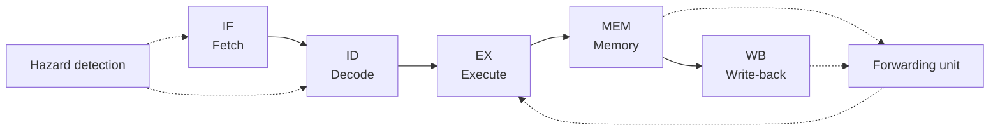

# riscv-vhdl


A **5-stage pipelined RISC-V (RV32I) CPU** written in VHDL and verified with
self-checking testbenches, Python (cocotb) tests and continuous integration.
The whole project runs in simulation: **no FPGA board required**.

## Why this project

- Practice real RTL design: synthesizable VHDL, pipelining, hazards, timing.
- Treat verification as a first-class part of the design, not an afterthought.
- Produce measurable results: maximum frequency, resource usage, CPI.

## Target microarchitecture



| Feature | Design choice |
| --- | --- |
| ISA | RV32I base integer instruction set |
| Pipeline | Classic 5 stages: IF, ID, EX, MEM, WB |
| Data hazards | Forwarding from EX/MEM and MEM/WB, stall on load-use |
| Control hazards | Branch resolved in EX, predict-not-taken, flush on taken branch |
| Memories | Separate instruction and data memories |
| Register file | 32 x 32-bit, two asynchronous read ports, one synchronous write port, `x0` hardwired to zero |

## Verification strategy

1. **Unit tests:** self-checking VHDL testbenches for every block, using `assert` statements.
2. **Instruction-level tests:** every supported instruction exercised, including corner cases.
3. **Program-level tests:** C programs compiled with the RISC-V GCC toolchain and run on the CPU, with results compared against a reference model.
4. **Continuous integration:** the full regression runs on every push (see the CI badge above).

## Getting started

### Requirements

- [GHDL](https://github.com/ghdl/ghdl) (VHDL-2008 support)
- [GTKWave](https://gtkwave.sourceforge.net/) to inspect waveforms
- `make`
- Optional: Python 3 with [cocotb](https://www.cocotb.org/), RISC-V GCC toolchain

On Ubuntu or WSL:

```bash
sudo apt install ghdl gtkwave make
```

### Run the tests

```bash
make test        # run every testbench
make alu_tb      # run a single testbench (name = file name in tb/, without .vhd)
make clean       # remove generated files
```

Any new file named `tb/<name>_tb.vhd` is picked up automatically.

### View waveforms

Each run writes a waveform file to `sim/`:

```bash
gtkwave sim/alu_tb.ghw
```

## Repository structure

```
rtl/     synthesizable VHDL (design under test)
tb/      self-checking testbenches (*_tb.vhd)
sim/     generated waveforms and build files (git-ignored)
docs/    project proposal and design notes
.github/ CI workflow
```

## Coding conventions

- VHDL-2008, `ieee.numeric_std` only.
- Synthesizable code stays in `rtl/`; delays and `wait for` belong in `tb/`.
- Every module has a testbench before the next one is started.
- Testbenches are self-checking: a failing check must make `make test` fail.

## Roadmap

Development is organized in phases, tracked through commits and GitHub milestones:

1. **Foundations:** toolchain, basic blocks, FSMs, first testbenches
2. **Single-cycle CPU:** ALU, register file, decoder, memories, datapath
3. **Pipelining:** five stages, forwarding, hazard detection, branch handling
4. **Program-level verification:** C programs, reference-model comparison, coverage, CI
5. **Synthesis and analysis:** timing and resource reports, CPI and performance comparison
6. **Documentation:** architecture diagrams, final report

Stretch goals: instruction/data cache, UART peripheral, M extension, custom instruction.

## Tools

GHDL, GTKWave, cocotb, Yosys / nextpnr, RISC-V GCC, GitHub Actions

## Author

**Chadha Ben Said**, computer engineering student at ENSI.
GitHub: [@bensaid25](https://github.com/bensaid25)

## License

MIT